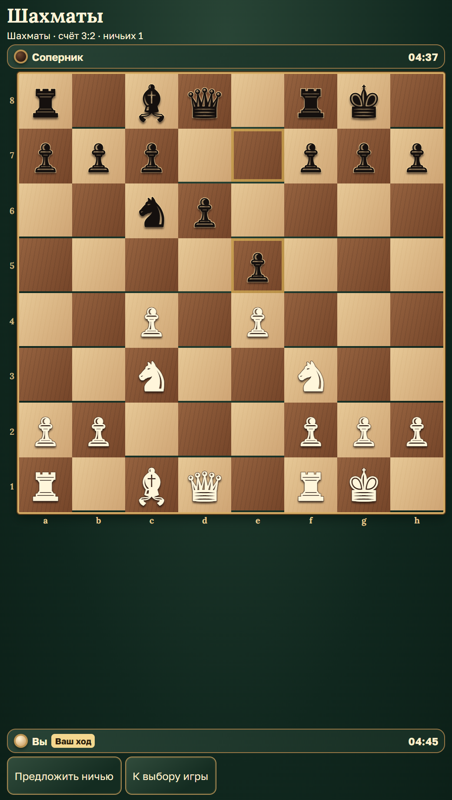
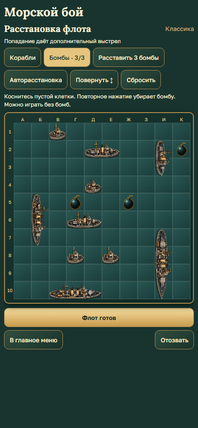
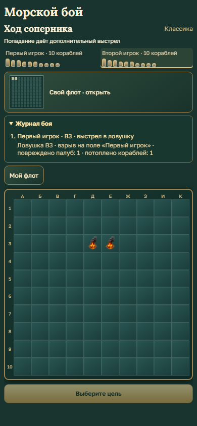

# Доска — настольные игры в Telegram

Статус: опубликовано · 27 ноября 2026. В Mini App есть шахматы, русские шашки, крестики-нолики и морской бой.

**[Открыть «Доску» в Telegram](https://t.me/DoskaPlayBot?startapp)**

Связано: [спецификация партии по ссылке](docs/specs/партия-по-ссылке.md) · [план первой версии](docs/plans/партия-по-ссылке.md).

## Как сыграть

В крестики-нолики можно сыграть с другом по ссылке, вдвоём на одном телефоне или против компьютера. Побеждает тот, кто первым соберёт три своих знака в ряд на поле 3 × 3.

Откройте [@DoskaPlayBot](https://t.me/DoskaPlayBot), нажмите «Играть», выберите игру и пригласите друга. Можно также ввести `@DoskaPlayBot` и пробел в любом чате, выбрать карточку игры и отправить её. Карточка открывает одну общую партию для двоих.

| Главное меню | Шахматная партия |
| --- | --- |
|  |  |
| **Русские шашки** | **Тренировки** |
|  |  |

| Расстановка флота и ловушек | Журнал морского боя |
| :---: | :---: |
|  |  |

На скриншотах показан интерфейс с демонстрационными позициями и счётом.

## Возможности

- Активную партию можно удалить из меню для обоих игроков. Счёт встреч при этом сохраняется.
- Партии с другом по ссылке, с часами или без них. Есть реванш со сменой цвета, предложение ничьей и уведомления о ходе.
- Счёт встреч отдельно для шахмат и шашек. Завершённые партии можно открыть из архива и пересмотреть по ходам.
- Тренировка с компьютером на двух уровнях сложности с отменой хода.
- Задачи дня и тематические серии с прогрессом и подсказками в два шага.
- Анимации ходов, отдельные звуки для хода и взятия, вибрация при превращении в дамку.

В обычных шашечных партиях действует правило **«за фук»**. Если игрок пропустил доступное взятие, соперник снимает одну из шашек, которые могли бить, и затем делает свой ход. Начатую серию нужно закончить. В задачах взятие обязательно.

## Морской бой

Сыграйте с другом по ссылке, вдвоём на одном телефоне или против компьютера. Расставьте флот вручную или автоматически. Корабли и ловушки можно перетаскивать мышью и пальцем. Красная область показывает, где корабль поставить нельзя.

- На пустых клетках своего поля можно поставить до трёх ловушек. Выстрел в ловушку вызывает взрыв крестом в тех же координатах на поле стрелявшего. Потопление корабля автоматически активирует соседние ловушки.
- Попадание даёт дополнительный выстрел, промах передаёт ход. После потопления соседние клетки отмечаются как вода и закрываются для выстрелов.
- В журнале боя видны последние 20 выстрелов с координатами, попаданиями, потоплениями и цепочками взрывов. Несработавшие ловушки соперника скрыты.

## Как устроен проект

| Где | Что находится |
| --- | --- |
| [Устройство Mini App](public/) | Игровая доска, меню и стили. |
| [Облачный сервер](src/worker.js) | Запросы Mini App, проверка подписи Telegram и вебхук бота. |
| [Правила игр](src/games.js) | Шахматы на `chess.js` и [движок русских шашек](src/draughts.js). |
| [База данных](migrations/) | Миграции Cloudflare D1 для партий, счёта встреч и прогресса. |
| [Локальный сервер](src/server.js) | Первая версия на Node.js и SQLite для разработки. Облачные режимы обслуживает Worker. |

## Для разработки

Нужен Node.js 24.

```sh
npm ci
npm test
```

`npm test` проверяет правила игр, подпись Telegram и базовые операции с комнатами локального сервера.
