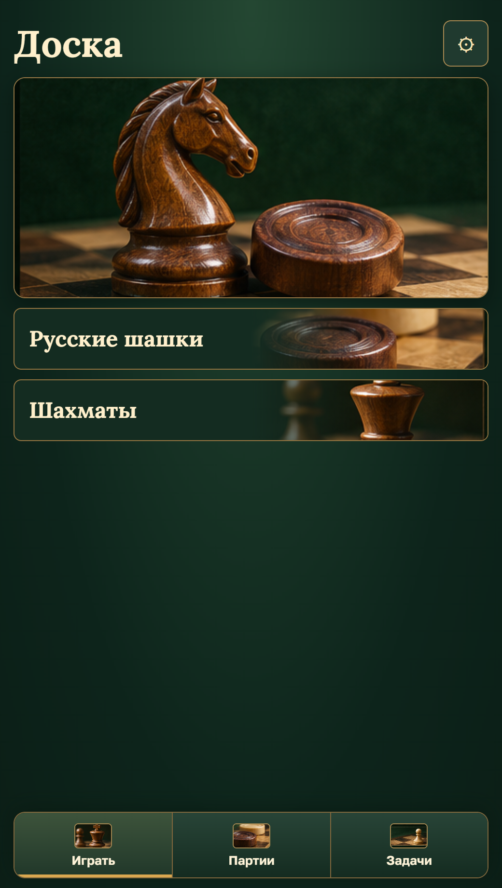
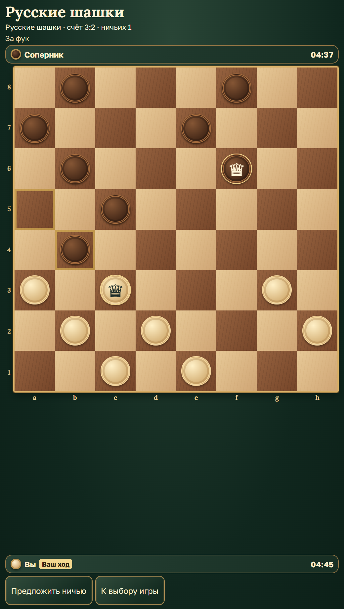
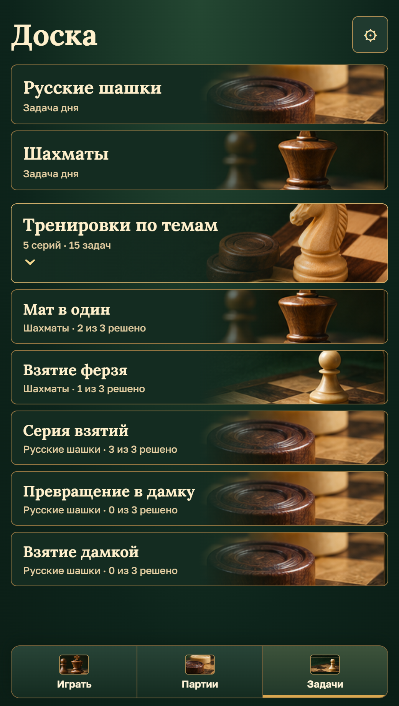

# Доска — настольные игры в Telegram

Статус: в работе · 23 ноября 2026. Mini App опубликовано. Доступны партии с другом и компьютером, архив и тематические тренировки.

**[Открыть «Доску» в Telegram](https://t.me/DoskaPlayBot?startapp)**

Связано: [спецификация партии по ссылке](docs/specs/партия-по-ссылке.md) · [план первой версии](docs/plans/партия-по-ссылке.md).

## Как сыграть

В крестики-нолики можно сыграть с другом по ссылке, вдвоём на одном телефоне или против компьютера. Побеждает тот, кто первым соберёт три своих знака в ряд на поле 3 × 3.

Откройте [@DoskaPlayBot](https://t.me/DoskaPlayBot), нажмите «Играть», выберите игру и пригласите друга. Можно также ввести `@DoskaPlayBot` и пробел в любом чате, выбрать карточку игры и отправить её. Карточка открывает одну общую партию для двоих.

| Главное меню | Шахматная партия |
| --- | --- |
|  |  |
| **Русские шашки** | **Тренировки** |
|  |  |

На скриншотах показан интерфейс с демонстрационными позициями и счётом.

## Возможности

- Партии с другом по ссылке, с часами или без них. Есть реванш со сменой цвета, предложение ничьей и уведомления о ходе.
- Счёт встреч отдельно для шахмат и шашек. Завершённые партии можно открыть из архива и пересмотреть по ходам.
- Тренировка с компьютером на двух уровнях сложности с отменой хода.
- Задачи дня и тематические серии с прогрессом и подсказками в два шага.
- Анимации ходов, отдельные звуки для хода и взятия, вибрация при превращении в дамку.

В обычных шашечных партиях действует правило **«за фук»**. Если игрок пропустил доступное взятие, соперник снимает одну из шашек, которые могли бить, и затем делает свой ход. Начатую серию нужно закончить. В задачах взятие обязательно.

## Как устроен проект

| Где | Что находится |
| --- | --- |
| [Устройство Mini App](public/) | Игровая доска, меню и стили. |
| [Облачный сервер](src/worker.js) | Запросы Mini App, проверка подписи Telegram и вебхук бота. |
| [Правила игр](src/games.js) | Шахматы на `chess.js` и [движок русских шашек](src/draughts.js). |
| [База данных](migrations/) | Миграции Cloudflare D1 для партий, счёта встреч и прогресса. |
| [Локальный сервер](src/server.js) | Первая версия на Node.js и SQLite для разработки. Облачные режимы обслуживает Worker. |

## Для разработки

Нужен Node.js 24.

```sh
npm ci
npm test
```

`npm test` проверяет правила игр, подпись Telegram и базовые операции с комнатами локального сервера.

### Свой бот на Cloudflare

1. Создайте бота в [BotFather](https://t.me/BotFather). Для карточек в переписке включите встроенный режим командой `/setinline`.
2. Создайте собственную базу D1. Укажите её идентификатор и имя своего бота в конфигурации Worker. Примените `schema.sql`, затем SQL-файлы из `migrations/` в порядке номеров.
3. Разверните Worker и добавьте `BOT_TOKEN` и `WEBHOOK_SECRET` через `wrangler secret put`. Храните их в секретах Cloudflare или в локальном файле окружения, исключённом из Git.
4. В BotFather укажите HTTPS адрес Worker для Main Mini App. Настройте [вебхук Telegram](https://core.telegram.org/bots/api#setwebhook) на путь `/telegram` с тем же `WEBHOOK_SECRET`. Включите обновления `message` и `inline_query`.

[wrangler.jsonc](wrangler.jsonc) описывает старого бота проекта, [wrangler.play.jsonc](wrangler.play.jsonc) — основного. Оба опубликованных бота подключены к одной базе партий.
